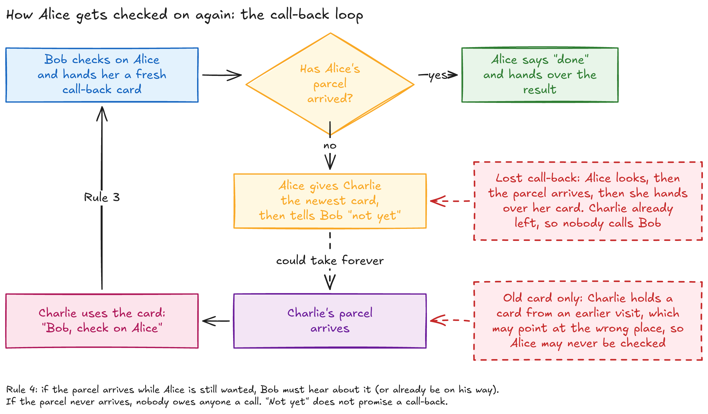
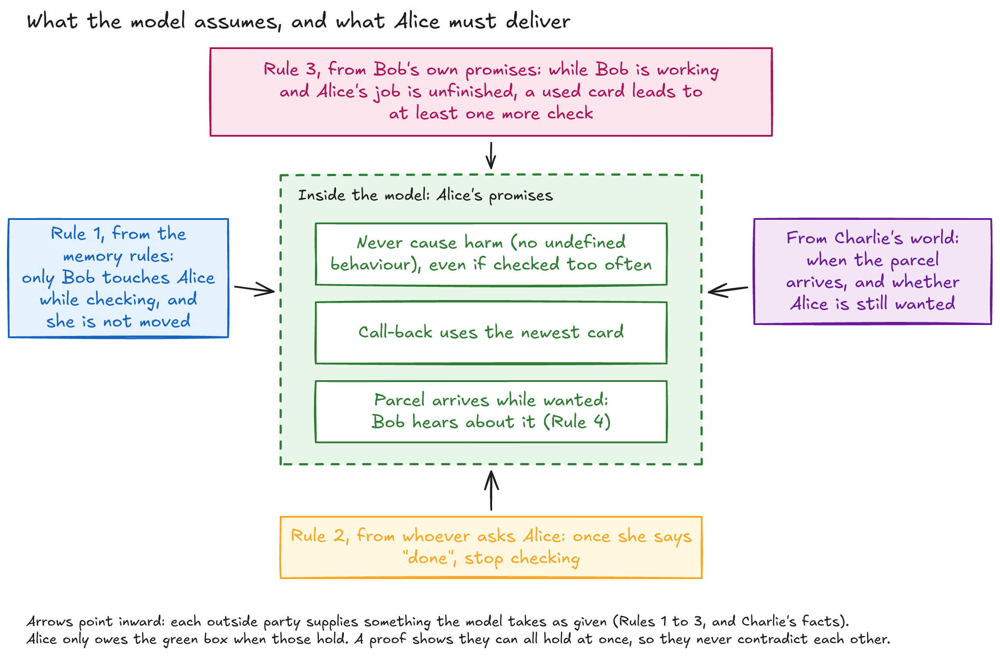

# Rust Futures, Explained and Modelled in Lean

   

> **Academic prototype.** This is a research proof of concept. It is not a verified library, it makes no guarantees about any production Rust code, and parts of the model are still open work, as marked throughout.

This project describes, precisely, how a piece of Rust code that *waits for something* is supposed to behave. It writes that description in Lean, a language in which a computer checks every step of a mathematical argument. The code in question is async Rust, Rust's way of writing code that waits without holding up a whole thread.

Build and toolchain instructions are in [DEPLOYMENTS.md](DEPLOYMENTS.md).

## The cast

The story has three characters. Every part of the model maps onto one of them.

**Alice** is a *future*. In Rust, a future is a piece of work that cannot finish straight away because it is waiting for something, such as a network message, a timer or another computation. Alice is waiting for a parcel. Once it arrives she can finish her job and hand over a *result*, meaning the value the work produces.

**Bob** is an *executor*. An executor is the part of a program that decides which piece of work runs next. Bob keeps a to-do list. Each entry on it is a *task*, Bob's word for one top-level job. A task can contain several futures inside it, the way one job can have sub-steps. If Alice is a sub-step, Bob checks the whole task, and the task in turn checks Alice. Bob never waits around: he checks on a task, and if it cannot move forward he goes off and does something else.

**Charlie** is the *outside world*: the network, the clock, and other *threads*. A thread is a separate strand of the program that runs at the same time as the others, possibly on another processor core. Charlie is the one who eventually delivers Alice's parcel, or never does.

## The one interaction everything rests on

Bob checking on Alice is called a *poll*. A poll goes like this:

1. Bob visits Alice and hands her a *call-back card*. In Rust this card is called a *waker*. It is a small object that, when used, tells Bob *come back and check on this task again*.
2. Alice looks for her parcel.
3. If it has arrived, she answers *Ready* and hands over her result. If not, she answers *Pending*, which means *not yet*. Before answering Pending, she leaves the call-back card with Charlie, so that Charlie can use it when the parcel turns up.

Using a card is called a *wake*. Bob may visit Alice many times, and he may hand her a different card each time.



The diagram shows the loop. Bob checks. Alice answers *not yet* and passes the newest card to Charlie. The parcel arrives, perhaps much later, perhaps never. Charlie uses the card, and Bob checks again. The red boxes are the two classic ways the loop breaks.

**The lost call-back.** Alice looks for the parcel and finds nothing. In the brief moment before she hands over her card, the parcel arrives and Charlie, holding no card, simply leaves. Alice then hands over a card that nobody will ever use. She now waits forever for a parcel that is already sitting at her door. The cure is to look and hand over the card as one indivisible step, so nothing can slip in between them.

**The old card.** Charlie still holds a card from an earlier visit and uses only that one. The old card may point at a place Bob has since stopped watching, so Alice may never be checked again. The cure is for Alice to always give Charlie the newest card.

## Why a model is needed

Rust's *compiler* is the program that turns Rust source code into a runnable program. Before doing so it enforces Rust's *type system*, a set of rules about what kind of value may go where. The type system guarantees that a poll has the right *shape*: Bob passes in a card, and Alice answers Ready or Pending. It does not guarantee that Alice *behaves* well. She could forget to hand over the card, or hand over an old one. The program would still compile, and then hang forever. The model describes the behaviour, so that it can be checked.

The model has to strike a balance. Too weak, and it cannot catch real bugs. Too strong, and it claims things Rust never promised, so every proof built on it describes an imaginary language. Each rule below is worded to land exactly on what Rust promises.

## What verification means here

What counts as *verification* is a choice, and this project's choice may change as the work grows. Other things being equal, that is, unless the project's scope or Rust itself changes, the definitions below stay fixed, and any change will be recorded with its reason. **At present, this project defines correctness, verification and soundness as follows.** Each definition follows an established framework from the literature on formal methods, the mathematical techniques for proving software correct, cited in brackets and listed under References.

### The framework

**The model is a labelled transition system.** A program is described by its states and by labelled steps between them, and its behaviour is the set of all event sequences, or *traces*, that those steps can produce (Keller, 1976). Alice is described this way; the details follow in the next section.

**A correctness property is a set of acceptable traces.** A property is something that is true or false of a whole trace. Properties come in two kinds (Lamport, 1977; Alpern and Schneider, 1985). A *safety* property says that something bad never happens: if it fails, it fails at a particular moment that you can point to. A *liveness* property says that something good eventually happens: no finite stretch of a trace can show that it has failed, because the good thing might still come later. In this model, *never cause harm*, *use the newest card* and *stop asking after Ready* are safety properties (each is defined under *The rules* below). Two rules introduced later, Rules 3 and 4, which promise that a check or a call-back eventually follows, are liveness properties. This split is why traces are infinite (explained below). It also limits what a recorded run of real code can show: a finite recording can catch a safety property failing, but it can neither prove nor disprove a liveness property.

**Correctness is conditional: assume, then guarantee.** Alice cannot be correct in a vacuum, because her behaviour depends on Bob and on Charlie. Following the *rely–guarantee* method (Jones, 1983), each rule is either something Alice may *rely* on, an assumption about her surroundings, or something she must *guarantee* in return. A future is **correct with respect to the rules** when every trace that meets all the assumptions also meets all the guarantees. In Lean this is called *conformance*, and its exact form is given under *All rules in one place*.

**Verification is refinement.** A real program $R$ is verified against a model $M$ when every behaviour of $R$ is a behaviour that $M$ allows (Hoare, 1972; Abadi and Lamport, 1991). Written as a formula:

$$\pi(\mathrm{Traces}(R)) \subseteq \mathrm{Traces}(M)$$

Here $\mathrm{Traces}(R)$ is the set of all event sequences that real runs of $R$ can produce, and $\mathrm{Traces}(M)$ is the set the model allows. $\pi$ (Greek *pi*) is the translation, called a *refinement mapping*, from what the Rust program actually does to events in the model's vocabulary. The symbol $\subseteq$ means *is contained in*: everything on the left also appears on the right. If refinement holds and $M$ is correct with respect to the rules, then $R$ is too, because every behaviour of $R$ is one that has already been shown to keep the rules. For the liveness rules this only works if $\pi$ never hides an execution that runs forever, since that would let a program that hangs look like one that finishes.

**Verification is not validation.** Checking that a program meets its rules is *verification*; checking that the rules are the right ones is *validation* (Boehm, 1984). Boehm's short forms are *building the product right* and *building the right product*. Proofs in Lean can only do the first. For this project, validation means checking that the rules say exactly what Rust's documentation promises, which is why every rule is tied to a sentence in that documentation and every rejected rule is backed by a real Rust program.

### The definitions, as they stand today

| Term | Present definition |
|---|---|
| Claim | One statement about how a future behaves |
| Proved | Lean has checked a complete proof of the claim from the rules |
| Witnessed | A real Rust program shows the behaviour the claim describes. This proves the behaviour *can* happen, never that it *always* does |
| Open | Neither proved nor witnessed; never reported as anything stronger |
| Correct | A model of a future is correct when every trace meeting the assumptions also meets the guarantees; in Lean this is `Conforms` |
| Verified | A Rust future is verified when it refines a model that is correct |
| Validated | A rule is validated when it matches the pinned Rust documentation and no real Rust program shows it to be too strong |
| Sound | A proof method is sound when it never accepts a false claim. A model is a sound description of Rust when it never rules out behaviour Rust allows |

Each kind of doubt is removed by a different kind of evidence, and the work is at a different stage for each.

| Doubt | Removed by | Where it stands |
|---|---|---|
| Do the rules say what Rust says? (validation) | Ties to the Rust documentation, and Rust programs for every rejected rule | In place for the rules on this page |
| Does a model keep the rules? (correctness) | A Lean proof that every trace of the model meets the guarantees | Full conformance not yet proved for any model. One all-traces result exists: every trace of the always-Pending model is free of harm and never Ready. Other proofs check individual example traces and show that the rules can all be met together |
| Does the code match the model? (refinement) | A refinement proof | Not started |

### Soundness assumptions, level by level

A proof checked by Lean is only as trustworthy as everything beneath it. The set of components that must be correct for an accepted claim to be true is called the *trusted base*. The aim is to keep it small, and to keep the checker small enough that a person could read it; this is known as the *de Bruijn criterion* (Barendregt and Wiedijk, 2005). The table lists, level by level from the logic down to the hardware, what this project currently assumes to be sound, and what would go wrong if that assumption failed.

| Level | Assumed sound | If this were wrong | How the risk is reduced |
|---|---|---|---|
| 1. Logic | Lean's logic (its *type theory*, the formal system Lean's proofs are written in) together with three standard axioms (statements Lean accepts without proof): *propositional extensionality* (two statements that imply each other are equal), *quotient soundness* (a technical rule for treating equivalent objects as the same) and the *axiom of choice* (if something exists, one can be picked) | Any statement could be proved, true or false | These are standard, widely used and studied foundations. Each headline theorem's axioms are printed during the build, and continuous integration (the automatic checks run on every change) fails if anything beyond these three appears |
| 2. Proof checker | Lean's *kernel*, the small core that checks every proof step (de Moura and Ullrich, 2021) | A wrong proof could be accepted | The kernel is small and separate from the parts of Lean that help write proofs. Proofs are not yet re-checked by an independent second checker |
| 3. Rule wording | That each Lean rule says what its plain-language version says | A proof would be correct about the wrong statement | Each rule is shown here next to its Lean form with a walkthrough, and tied to the Rust documentation |
| 4. Outside descriptions | The descriptions of Rust's memory rules (Rule 1), of Bob (Rule 3) and of Charlie's world (Rule 4) | A result could rest on an impossible or unrealistic environment | Each one is an explicit input to every theorem that uses it, never a hidden axiom. Well-studied models exist to supply the memory rules (Jung et al., 2018) |
| 5. Model of the code | That the Lean model $M$ describes the real future $R$, through the mapping $\pi$ | Proofs would hold for a description, not for the code | The refinement proof; not yet done |
| 6. Translation | Once refinement is attempted, the tool that translates Rust into Lean, such as Aeneas (Ho and Protzenko, 2022) | The Lean version could differ from the code that runs | Out of scope until refinement begins |
| 7. Below Rust | The Rust compiler, the standard library meeting its own documentation, the operating system and the hardware | A verified program could still misbehave when run | Out of scope; trusted, as in almost all software verification |
| 8. Evidence tools | A recording version of Bob (an instrumented executor) that writes down real Rust runs, and the checker that keeps the *claim catalogue*, the list of every claim with its source and status, in step with the code | A witness could be recorded wrongly, or a status could drift | Witnesses are used only to *disprove* rules, never to prove them; the catalogue checker confirms references exist but not that their wording is faithful, which remains a human check |

Levels 1 and 2 concern the *proof method*. Levels 3 to 6 concern the *model*, which is where most of the open work lies. Levels 7 and 8 sit outside both.

**What a failed check tells you.** If a future fails a rule, the cause is at one of these levels. The future may be faulty, as with the lost call-back. The rule may be worded too strongly for Rust (level 3), in which case some Rust program will show the behaviour the rule forbids. Or an outside description may be wrong (level 4). A failure is investigated at every level before anything is concluded.

**What verification does not mean.** It does not mean Rust futures are correct in general. It does not mean a verified future is fast, fair to other tasks or finishes within any time limit, because the rules deliberately say nothing about time. And it does not mean the real program behaves like the model, unless the refinement step has been completed.

## How the model is built

### Events: what an observer can see

The model records everything that happens as a sequence of *events*. Here is the full list of event kinds as written in Lean, followed by a walkthrough.

```lean
inductive Event (α : Type) where
  | pollBegin (call : CallId) (waker : WakerId)
  | pollReturn (call : CallId) (result : Poll α)
  | wake (waker : WakerId)
  | taskPollBegin (task : TaskId)
  | external
  | panic (call : CallId)
  | abort
  | undefinedBehaviour
  | drop
  | internal
  deriving DecidableEq, Repr
```

`inductive Event` declares a new kind of thing called `Event`, together with the complete list of forms it can take. Each line beginning with `|` is one form.

`(α : Type)` makes the definition work for any kind of result. The letter $\alpha$ (Greek *alpha*) is a placeholder for *whatever type of result Alice hands over*, such as a number or a piece of text. In Lean the colon `:` means *has type* or *is a*, so `α : Type` reads *alpha is a type*.

`CallId`, `WakerId` and `TaskId` are all just natural numbers ($0, 1, 2, \ldots$) used as labels: one numbers Bob's visits, one numbers the cards, and one numbers the tasks on Bob's list.

`pollBegin (call : CallId) (waker : WakerId)` is Bob starting visit number `call`, handing over card number `waker`.

`pollReturn (call : CallId) (result : Poll α)` is that visit ending with Alice's answer. A `Poll α` is either `.pending` (*not yet*) or `.ready v`, where `v` is a result of type $\alpha$. A visit is split into a *begin* event and a *return* event because Charlie can use a card while Bob is still standing at Alice's door. That in-between moment is exactly where the lost call-back happens.

`wake (waker : WakerId)` is someone using card number `waker`.

`taskPollBegin (task : TaskId)` is Bob picking task number `task` off his to-do list.

`external` is Charlie doing something, for example the parcel arriving.

`panic (call : CallId)` is a *panic*: Rust's name for a controlled crash of one piece of work. It carries the visit number so that we know which visit crashed. `abort` is the whole program stopping at once, which belongs to no particular visit.

`undefinedBehaviour` is something the language forbids outright, such as reading *memory* (the place where a running program keeps its data) that does not belong to it. The model never allows this event. It is the label for what must never happen.

`drop` is Alice being thrown away before she finishes, because nobody wants her result any more. `internal` is a step nobody outside can see. Neither needs a number, because neither belongs to a particular visit or card.

`deriving DecidableEq, Repr` asks Lean to generate, automatically, a way to test two events for equality and a way to print them. It adds no meaning to the model.

### Traces

A *trace* is the full story of one execution: event 0, event 1, event 2, and so on forever.

```lean
abbrev Trace (α : Type) := Nat → Event α
```

`abbrev` introduces a shorthand name. `Nat` is the natural numbers $0, 1, 2, \ldots$. The arrow `→` between types means *a function from … to …*: give it a position and it gives back the event at that position.

A trace goes on forever on purpose. If it stopped, the model could not tell *Alice finished* apart from *we stopped watching before she finished*. A story whose work is done simply carries on with `internal` events.

Throughout, `t` names a trace. Writing two names side by side means applying a function to an input, so `t i` means *the event at position $i$ of trace $t$*.

Each trace describes **one future**: it is Alice's view of the execution, containing her visits and the cards used for her. Events that belong to other futures are left out. Without this, a card used for some unrelated future would wrongly count against Alice.

### Alice as a machine with states

Alice has a *state*: what she currently remembers, such as *no parcel yet, card number 3 handed to Charlie*. The model describes her as a *transition system*, a set of states plus a rule saying which state may follow which, under which event.

```lean
structure FutureModel (σ α : Type) where
  initial : σ → Prop
  step : σ → Event α → σ → Prop
```

`structure` bundles several named parts into one object. $\sigma$ (Greek *sigma*) is the type of Alice's possible states.

`Prop` is the type of *statements*: things that are either true or false, such as $2 < 3$. A function that ends in `Prop` is therefore a yes-or-no question.

`initial : σ → Prop` asks *may Alice start in this state?*

`step : σ → Event α → σ → Prop` asks *may Alice go from this first state to this second state when this event happens?* Several arrows in a row mean the function takes several inputs, one after another.

`step` is a yes-or-no question rather than a rule that picks *the* next state. A state may therefore have several allowed next states, which is how the model represents Charlie's unpredictability. It may also have none for some event, which is how the model says *that cannot happen here*.

## Reading the Lean in the rules

Every rule below is built from the same few symbols.

| Lean | Mathematics | Read it as |
|---|---|---|
| `∀ x,` | $\forall x$ | *for every* $x$ |
| `∀ i w,` | $\forall i\, \forall w$ | *for every* $i$ *and every* $w$ |
| `∃ x,` | $\exists x$ | *there is some* $x$ *such that* |
| `A → B` (between statements) | $A \Rightarrow B$ | *if* $A$ *then* $B$; a chain `A → B → C` reads *if* $A$, *and if* $B$, *then* $C$ |
| `∧` | $\land$ | *and* |
| `∨` | $\lor$ | *or* (at least one) |
| `¬` | $\lnot$ | *not* |
| `=`, `≠` | $=$, $\neq$ | *is*, *is not* |
| `<`, `≤` | $<$, $\leq$ | *comes before*, *comes before or at* (positions in a trace) |
| `.wake w` | | the event of kind `wake` with card `w`; the leading dot means *one of the forms of `Event`* |
| `P.name` | | the part called `name` inside the bundle `P`, as in `X.liveFrom` |
| `w'` | $w'$ | read *w-prime*: another card, possibly different from `w` |
| `{α : Type}` | | *for any type* $\alpha$; any letters in curly braces are types Lean works out by itself |
| `def Name … : Prop :=` | | *Name is the statement that …* |

## The rules

The model rests on three outside assumptions (Rules 1 to 3) and three promises Alice must keep (Rule 4, the newest-card promise, and never causing harm). Rule 4 also uses facts supplied by Charlie's world.

None of these is a Lean `axiom`, a statement Lean accepts without proof. Each is an ordinary named definition, and any theorem that needs a rule must take it as an explicit input, so it is always visible what a result depends on. A global axiom, by contrast, would apply to every future ever written, could never be checked against a particular one, and if two axioms contradicted each other Lean could go on to *prove* anything at all.



Each rule carries a status taken from the project's claim catalogue. **Proved** means Lean has checked a complete proof. **Modelled** means the rule is written precisely in Lean but nothing has yet been proved about it. **Assumed** means it is taken as given from outside.

### Rule 1 (assumption): only Bob touches Alice, and she does not move

*In plain terms.* While Bob checks on Alice, nobody else may touch her. Once Alice is *pinned*, which Rust requires before her first visit, she must stay at the same place in memory. Each piece of data in memory sits at an *address*, and Alice may keep notes that point at her own address. Moving her would leave those notes pointing at the wrong place. Futures that Rust labels *Unpin* keep no such notes, so they may move freely.

*In Lean.*

```lean
structure PinModel (σ : Type) extends AccessModel σ where
  isUnpin : Prop
  pinValid : σ → Prop
  unpin_trivial : isUnpin → ∀ s, pinValid s

def PinModel.ValidPoll {σ : Type} (P : PinModel σ) (s : σ) : Prop :=
  P.exclusiveAccess s ∧ P.pinValid s
```

```lean
structure AccessModel (σ : Type) where
  exclusiveAccess : σ → Prop
```

`PinModel` is a description of Rust's memory rules, supplied from outside this project. `extends AccessModel σ` means it also contains every part of `AccessModel`, which has a single part, `exclusiveAccess : σ → Prop`: *does only Bob have hold of Alice in this state?* `isUnpin` is the statement *Alice's type is Unpin*. `pinValid s` is *Alice's pinning promise holds in state* $s$. `unpin_trivial` requires that, if Alice is Unpin, her pinning promise holds in every state.

`ValidPoll` reads: in state $s$, Alice has exclusive access and her pinning promise holds.

*Status: assumed.* Rust's memory rules are taken as given. Rust's further promise that a pinned value stays put until it is thrown away is not represented in this model.

### Rule 2 (assumption): once Alice says Ready, stop asking

*In plain terms.* Whoever polls Alice should not poll her again after she answers Ready. This is a duty of the *asker*, not a promise by Alice. Rust does let the asker poll again, and when that happens Alice may panic, give another answer, or never answer. She must never cause undefined behaviour. So the model does not treat *Ready* as a state she can never leave; doing so would forbid behaviour Rust allows.

*In Lean.* Two helper definitions come first.

```lean
def ReadyAt {α : Type} (t : Trace α) (i : Nat) : Prop :=
  ∃ c v, t i = .pollReturn c (.ready v)

def PollBeginAt {α : Type} (t : Trace α) (i : Nat) : Prop :=
  ∃ c w, t i = .pollBegin c w
```

`ReadyAt t i`: at position $i$, some visit $c$ ended with Ready and some result $v$. `PollBeginAt t i`: at position $i$, some visit $c$ began with some card $w$.

```lean
def CallerStopsAtReady {α : Type} (t : Trace α) : Prop :=
  ∀ i, ReadyAt t i → ∀ j, i < j → ¬ PollBeginAt t j
```

For every position $i$, if Alice answered Ready at $i$, then for every later position $j$, no visit begins at $j$.

*Status: modelled.* Rule 2 is an assumption in the sense that Alice relies on it. Its status is *modelled* rather than *assumed* because, unlike Rules 1 and 3, it does not come from an outside description: it is a property of the trace itself, written out in full above, so nothing about it is taken on trust.

### Rule 3 (assumption): a used card leads to another check

*In plain terms.* If Charlie uses Alice's card while Bob is still working and Alice's task is unfinished, then Bob will check that task again at least once, at some later point. Rust's documentation makes this promise. The rule deliberately says nothing about *how soon*. It does not say Alice will be Ready next time, or that every sub-step inside the task is checked. Several card uses may also be answered by a single check.

*In Lean.*

```lean
structure ExecutorModel (α : Type) where
  env : WakerEnv
  liveFrom : Nat → TaskId → Prop
  hb : Nat → Nat → Prop
  hb_of_lt : ∀ i j, i < j → hb i j
  hb_trans : ∀ i j k, hb i j → hb j k → hb i k

def WakeDelivery {α : Type} (X : ExecutorModel α) (t : Trace α) : Prop :=
  ∀ i w, t i = .wake w → X.liveFrom i (X.env.taskOf w) →
    ∃ j, i < j ∧ X.hb i j ∧ t j = .taskPollBegin (X.env.taskOf w)
```

```lean
structure WakerEnv where
  taskOf : WakerId → TaskId
```

`ExecutorModel` is a description of Bob. Its part `env` is a `WakerEnv`, Bob's register of cards, whose only part `taskOf` says which task each card belongs to, so `env.taskOf w` is the task of card `w`. `liveFrom i task` says whether, at position $i$, Bob is still running and that task is unfinished. `hb i j` says position $i$ *happens before* position $j$: whatever happened at $i$ is visible to whoever acts at $j$. For example, if Charlie's thread uses a card and Bob's thread then picks up the task, `hb` records that Bob's pick-up really came after, and saw, the card use. The last two lines are sanity conditions: *happens before* must include plain *earlier than*, and it must chain (if $i$ is before $j$ and $j$ is before $k$, then $i$ is before $k$).

`WakeDelivery` reads: for every position $i$ and card $w$, if card $w$ is used at $i$, and its task is live at that moment, then there is a later position $j$ where Bob picks up that same task, and $i$ happens before $j$.

A proof checks that this rule can actually fail: a used card on a live task, with no later pick-up, breaks it.

*Status: assumed.* One gap remains. A description of Bob may still declare every task finished from the start, in which case the rule never applies. The simpler of the two consistency witnesses below does exactly that. Closing the gap needs a concrete executor.

### Rule 4 (promise): if the parcel arrives, someone must hear about it

*In plain terms.* The tempting version is *if Alice says not yet, she will eventually be woken*. That is false. If the parcel never arrives, nobody owes anyone a call, and that is correct behaviour. The correct version is conditional. After Alice says not yet, if the parcel later arrives and Alice is still wanted, then eventually either a card is used or Bob starts a new visit. A visit already on its way counts, because it will find the parcel by itself.

Whether *the parcel has arrived* is decided by a test that Charlie's description supplies, applied to Alice's state. It is never defined as *a card was used*. If it were, the rule would collapse into *if a card was used, then a card is used*, which is true and says nothing. Such circular definitions are the most common way a *liveness* rule, a rule that something good eventually happens, quietly proves nothing.

*In Lean.*

```lean
structure EnvironmentModel (σ : Type) where
  progressOpportunity : σ → Prop
  stillInterested : σ → Prop

def ProgressNotifies {σ α : Type} (E : EnvironmentModel σ) (s : Nat → σ) (t : Trace α) : Prop :=
  ∀ i c, t i = .pollReturn c .pending →
    ∀ j, i < j → E.progressOpportunity (s j) → E.stillInterested (s j) →
      ∃ k, j ≤ k ∧ ((∃ w, t k = .wake w) ∨ PollBeginAt t k)
```

`EnvironmentModel` is Charlie's description. `progressOpportunity` answers *has the parcel arrived?* and `stillInterested` answers *is Alice still wanted?*, both about a given state of Alice. `s : Nat → σ` gives Alice's state at each position, so `s j` is her state at position $j$.

`ProgressNotifies` reads: for every visit $c$ that ended with Pending at position $i$, and every later position $j$ where the parcel is there and Alice is still wanted, there is some position $k$ at or after $j$ where a card is used or a new visit begins.

Two proofs keep the rule honest. If the parcel never arrives, the obligation never applies. A separate proof exhibits a story in which Alice answers Pending and no card is ever used, which refutes *not yet implies a call-back*.

*Status: modelled.*

### The newest-card promise

*In plain terms.* If any card is used while Alice is waiting, meaning after a Pending answer and before Bob's next visit, then the card from Bob's most recent visit must be among those used. Using older cards as well is allowed; it only causes a harmless extra check. Using *only* an old card is the old-card bug.

*In Lean.* Two helpers first.

```lean
def SuspendedWith {α : Type} (t : Trace α) (i : Nat) (w : WakerId) : Prop :=
  ∃ b c, b < i ∧ t b = .pollBegin c w ∧ t i = .pollReturn c .pending

def NoPollBetween {α : Type} (t : Trace α) (i k : Nat) : Prop :=
  ∀ m c w, i < m → m < k → t m ≠ .pollBegin c w
```

`SuspendedWith t i w`: visit $c$ began earlier, at position $b$, with card $w$, and ended with Pending at position $i$. `NoPollBetween t i k`: no visit begins strictly between positions $i$ and $k$.

```lean
def WakesLatest {α : Type} (t : Trace α) : Prop :=
  ∀ i w, SuspendedWith t i w →
    ∀ k w', i < k → NoPollBetween t i k → t k = .wake w' →
      ∃ k', i < k' ∧ NoPollBetween t i k' ∧ t k' = .wake w
```

Whenever Alice is waiting with newest card $w$, if any card $w'$ is used at a position $k$ before Bob's next visit, then card $w$ itself is used at some position $k'$ in that same waiting period.

Two proofs show the rule is balanced. It rejects a story where only an old card is used, and it accepts one where the newest card is used. *Status: modelled; both checks proved.*

### The never-cause-harm promise

```lean
def NoUB {α : Type} (t : Trace α) : Prop := ∀ i, t i ≠ .undefinedBehaviour
```

At no position is the event undefined behaviour. On its own this definition places no condition on the trace, so it would cover stories where the asker breaks Rule 2. Inside the bundle below, however, Alice's promises are required only on traces that meet the assumptions, and Rule 2 is one of them. So, as things stand, conformance does not yet demand safety when Alice is polled after Ready, even though Rust does. *Status: modelled.* Closing that gap, and making the promise depend on Rule 1 holding at every visit, is open work.

### All rules in one place

First, what it means for a trace to be a possible story of a model:

```lean
def FutureModel.IsRunWith {σ α : Type} (M : FutureModel σ α) (s : Nat → σ) (t : Trace α) : Prop :=
  M.initial (s 0) ∧ ∀ n, M.step (s n) (t n) (s (n + 1))
```

`M.IsRunWith s t` holds when the states `s` and the events `t` fit the model `M` together: the first state `s 0` is a permitted starting state, and for every position $n$, the model allows the step from state `s n` to state `s (n + 1)` under event `t n`.

The rules are then bundled into two structures, and a third definition says what it means for a model to keep them.

```lean
structure Assumptions {σ α : Type} (C : Context σ α) (s : Nat → σ) (t : Trace α) : Prop where
  -- Rule 1: every poll starts from a state with valid access
  validAccess : ∀ i, PollBeginAt t i → C.memory.ValidPoll (s i)
  -- Rule 2: the caller does not poll after Ready
  callerProtocol : CallerStopsAtReady t
  -- Rule 3: wakes on live tasks are delivered
  wakeDelivery : WakeDelivery C.executor t
```

`C` is a `Context`: the three outside descriptions together, `C.memory` (Rule 1), `C.executor` (Bob) and `C.environment` (Charlie). Lines beginning with `--` are comments that Lean ignores. The three parts read: every visit starts from a state where Rule 1 holds; Rule 2 holds; Rule 3 holds.

```lean
structure Obligations {σ α : Type} (C : Context σ α) (s : Nat → σ) (t : Trace α) : Prop where
  noUB : NoUB t
  latestWaker : WakesLatest t
  -- Rule 4: progress obligates notification
  progressNotifies : ProgressNotifies C.environment s t
```

Alice's three promises: never cause harm, use the newest card, and Rule 4.

```lean
def Conforms {σ α : Type} (C : Context σ α) (M : FutureModel σ α) : Prop :=
  ∀ s t, M.IsRunWith s t → Assumptions C s t → Obligations C s t
```

This is the definition of correctness from the framework above, the rely–guarantee form. A model `M` conforms in context `C` when, for every sequence of states `s` and trace `t`, if they are a run of `M` and they meet the assumptions, then they meet the obligations.

Two proofs show that the bundle is *consistent*, meaning the rules can all hold at once. The first uses Alice waiting forever. It is simple, but each conditional rule holds there only because its trigger never fires: no card is used, no task is live and no parcel arrives. The second is a short story in which everything happens. Bob picks up the task and visits with card 0. Alice answers Pending. The parcel arrives and card 0 is used. Bob picks the task up again, visits with card 1, and Alice answers Ready. The proof shows that this story is a run of a small model of Alice, that it meets every assumption, and that it keeps every promise. Rules 3 and 4 and the newest-card promise all take effect. Rule 1 is met only trivially, because the memory description used there allows everything. *Status: proved.*

## What the rules deliberately do not say

Each statement below sounds reasonable, and each is false for real Rust. The model must leave room for all of them. Each one is shown by a real Rust program, and some are also proved in Lean.

| Tempting statement | Why it is false | Lean status |
|---|---|---|
| Every future eventually finishes | Rust's standard `pending` future waits forever | Proved |
| *Not yet* means a call-back will come | A story with Pending and no card ever used is allowed | Proved |
| Every future uses its card | Rust's standard `ready` future finishes on the first visit without touching it | Rust only |
| A call-back means the next answer is Ready | A future may use its own card and still answer Pending next time | Rust only |
| *Ready* is final and polling again is harmless | Async functions generated by the Rust compiler panic when polled again; this is the behaviour of the pinned compiler release, not a documented promise | Rust only |
| Ready means success | The result can itself be an error | Rust only |
| Throwing Alice away undoes what she did | Effects on the outside world remain | Rust only |

The model must also be strong enough to reject faulty behaviour. The newest-card promise rejects a story in which only an old card is used, and that rejection is proved. A state in which Alice is waiting, the parcel is there, and the newest card was never used is rejected by the no-lost-call-back property, and that rejection is proved. That property is:

```lean
def NoLostWakeup {σ : Type} (O : LostWakeObservables σ) (reachable : σ → Prop) : Prop :=
  ∀ s, reachable s → O.pending s → O.valueAvailable s →
    O.notificationOutstanding s ∨ O.pollInFlight s
```

`O` supplies four yes-or-no questions about a state: is Alice waiting, has the parcel arrived, has the newest card been used, and is a visit under way. `reachable s` asks whether Alice can actually get into state `s`. The property reads: in every reachable state where Alice is waiting and the parcel has arrived, either the newest card has been used or a visit is under way. Whether a particular faulty program can actually *reach* that state has not yet been proved.

## The model as a system

The model can also be read as a system: parts connected by flows of information.

**Purpose.** A system's purpose shows in what it does. Alice's purpose is to deliver her result once that becomes possible, without anyone standing idle while she waits.

**Things that build up and drain.** Two quantities rise and fall over time. The first is Alice's state, changed only by visits and ended by a drop. The second is *outstanding call-backs*: card uses that Bob has not yet answered with a check. Card uses add to it and checks clear it. It behaves like an on/off switch rather than a counter, because ten card uses still only call for *at least one more check*. Alice is safe from being forgotten only while this switch is on, or a visit is under way, whenever the parcel is there.

**The self-correcting loop.** The call-back loop in the first diagram keeps steering the system back toward one goal: no parcel that has arrived goes unnoticed. The lost call-back and the old card are two ways this loop breaks.

**Delays.** There are two. Between a card being used and Bob's next check, any amount of time may pass; the model promises the check comes, never when, because a deadline would be stronger than Rust. Between the start and the end of a visit, other events can happen, which is why a visit is two events rather than one.

**The edge of the model.** Every model draws a line between what it describes and what it takes as given, and a badly drawn line hides causes. This model describes the call-back protocol and Alice's promises. It takes Rust's memory rules, Bob's scheduling and Charlie's world as given. It does not describe timing, fairness between tasks, or performance. Two rules are recorded but not yet stated: that Alice answers quickly instead of holding Bob up, and exactly what must hold when Alice is thrown away midway.

## Checking the model against Rust

Three checks connect the model to real Rust. None is complete.

Real Rust futures should produce stories the model accepts. A small instrumented executor, a *Bob* that writes down everything he sees, records such stories using the same events as the model, so a recording can be compared directly against Alice's transition rule. It currently runs on one thread only, so it cannot yet produce Charlie using a card in the middle of a visit from another thread.

Each rule should trace back to a specific sentence in the documentation of one fixed Rust release. A machine-checked catalogue records that link and each claim's status, and it refuses any status that has no proof or Rust program behind it.

A *refinement proof* should show that every real execution, once translated into events, is a story the model allows. Only then does a property proved in Lean also hold for the Rust code. The general argument for carrying a property across is proved, though it is short and simple. No real Rust implementation is connected to the model yet, so **no property currently carries over to compiled Rust code**. Aeneas, a tool that translates a subset of Rust into Lean, is a candidate for building that connection.

## References

Abadi, M. and Lamport, L. (1991) 'The existence of refinement mappings', *Theoretical Computer Science*, 82(2), pp. 253–284. doi:10.1016/0304-3975(91)90224-P.

Alpern, B. and Schneider, F.B. (1985) 'Defining liveness', *Information Processing Letters*, 21(4), pp. 181–185. doi:10.1016/0020-0190(85)90056-0.

Barendregt, H. and Wiedijk, F. (2005) 'The challenge of computer mathematics', *Philosophical Transactions of the Royal Society A: Mathematical, Physical and Engineering Sciences*, 363(1835), pp. 2351–2375. doi:10.1098/rsta.2005.1650.

Boehm, B.W. (1984) 'Verifying and validating software requirements and design specifications', *IEEE Software*, 1(1), pp. 75–88. doi:10.1109/MS.1984.233702.

de Moura, L. and Ullrich, S. (2021) 'The Lean 4 theorem prover and programming language', in Platzer, A. and Sutcliffe, G. (eds) *Automated Deduction – CADE 28*. Lecture Notes in Computer Science, vol. 12699. Cham: Springer, pp. 625–635. doi:10.1007/978-3-030-79876-5_37.

Ho, S. and Protzenko, J. (2022) 'Aeneas: Rust verification by functional translation', *Proceedings of the ACM on Programming Languages*, 6(ICFP), article 116, pp. 711–741. doi:10.1145/3547647.

Hoare, C.A.R. (1972) 'Proof of correctness of data representations', *Acta Informatica*, 1(4), pp. 271–281. doi:10.1007/BF00289507.

Jones, C.B. (1983) 'Tentative steps toward a development method for interfering programs', *ACM Transactions on Programming Languages and Systems*, 5(4), pp. 596–619. doi:10.1145/69575.69577.

Jung, R., Jourdan, J.-H., Krebbers, R. and Dreyer, D. (2018) 'RustBelt: securing the foundations of the Rust programming language', *Proceedings of the ACM on Programming Languages*, 2(POPL), article 66. doi:10.1145/3158154.

Keller, R.M. (1976) 'Formal verification of parallel programs', *Communications of the ACM*, 19(7), pp. 371–384. doi:10.1145/360248.360251.

Lamport, L. (1977) 'Proving the correctness of multiprocess programs', *IEEE Transactions on Software Engineering*, SE-3(2), pp. 125–143. doi:10.1109/TSE.1977.229904.
